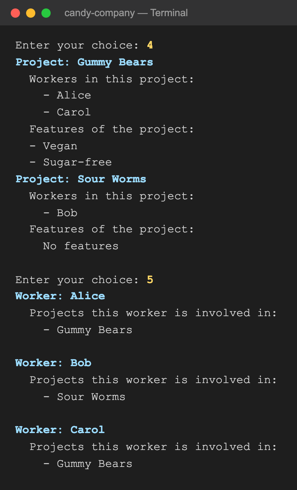
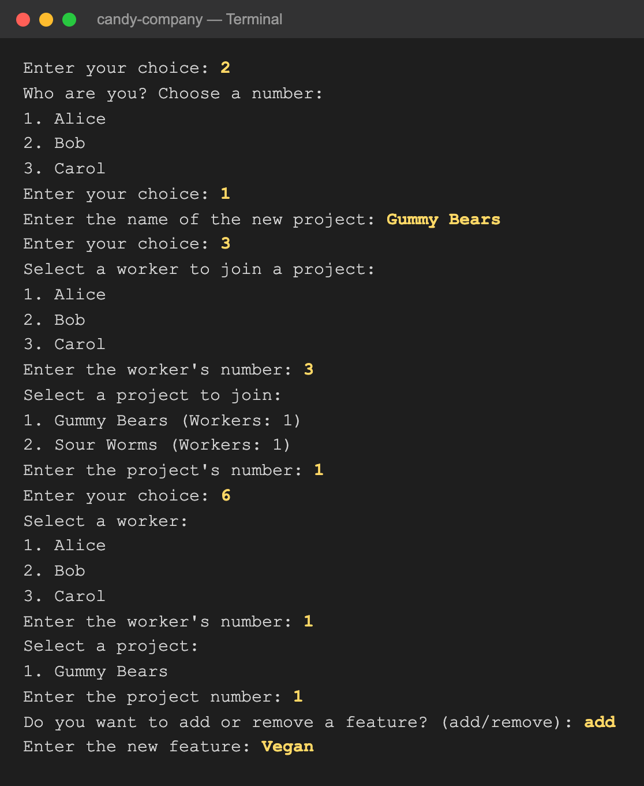
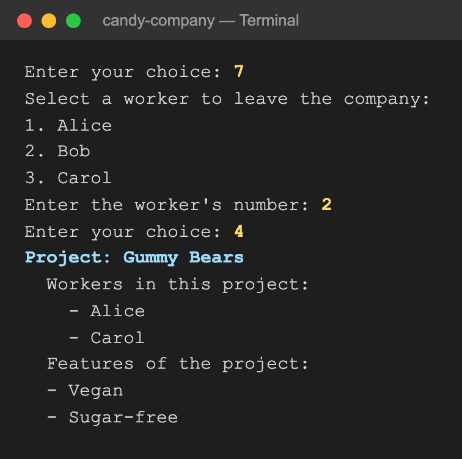
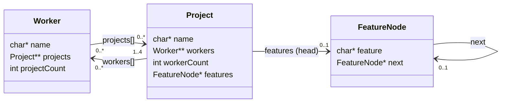

# Management System for a Candy Company

A menu-driven C program that manages the employees and projects of a gummy candy company. Workers join the company, open projects, join each other's projects, and add or remove features. When someone leaves, the program cleans up after them. Everything is stored in dynamically allocated memory: names of any length, arrays that grow on demand, and a linked list of features per project. All of it is freed on exit.

<p align="center">
  
</p>

## Contents

- [Build and run](#build-and-run)
- [The menu](#the-menu)
- [A session in pictures](#a-session-in-pictures)
- [Rules and limits](#rules-and-limits)
- [Architecture](#architecture)
  - [Data model](#data-model)
  - [Memory management](#memory-management)
  - [Functions](#functions)
- [Project structure](#project-structure)

## Build and run

`ex_5.h` must be in the same folder as the source file.

```bash
cc -std=c99 -Wall -o candy "Management system for a candy company.c"
./candy
```

## The menu

```
Welcome!
Please select the desired option:
1. Join the company
2. Open a new project
3. Join an existing project
4. See what projects are in work
5. See which people are in what projects
6. Work on existing project
7. Leave the company
8. Exit
Enter your choice:
```

| Option | What it does |
|---|---|
| 1. Join the company | Adds a new worker. Names must be unique. |
| 2. Open a new project | A worker opens a project and automatically becomes its first member. Project names must be unique. |
| 3. Join an existing project | Adds a worker to someone else's project (up to 4 workers per project). |
| 4. See what projects are in work | Lists every project with its workers and features. |
| 5. See which people are in what projects | Lists every worker with the projects they're in. |
| 6. Work on existing project | A worker picks one of their projects and adds or removes a feature. |
| 7. Leave the company | Removes a worker from every project, and deletes the projects they were working on alone. |
| 8. Exit | Frees all memory and ends the program. |

Choices are made by number from numbered lists. Text answers are case-sensitive: option 6 expects exactly `add` or `remove`.

## A session in pictures

Three workers join: Alice, Bob and Carol. **Alice opens "Gummy Bears", Carol joins it, and Alice adds a feature:**

<p align="center"></p>

**Bob opens "Sour Worms" and Alice adds a second feature. Options 4 and 5 show the whole company from both sides:**

<p align="center"></p>

**Bob leaves.** "Sour Worms" had no other workers, so it is deleted, and only "Gummy Bears" remains:

<p align="center"></p>

## Rules and limits

| Rule | Value |
|---|---|
| Workers in the company | at most 50 |
| Projects in the company | at most 100 |
| Workers per project | at most 4 |
| Worker names | unique in the company |
| Project names | unique in the company |
| Feature names | unique within their project |
| Name length | unlimited (read character by character into a growing buffer) |

- A worker can't join a project twice ("The worker is already part of the project").
- Option 6 only offers the projects the chosen worker belongs to.
- When a worker leaves:
  - every project where they were the **only** worker is deleted, together with its features;
  - they are removed from every other project, and the remaining workers keep their order;
  - the company's worker list is compacted, so the numbering stays continuous.
- Invalid input never crashes the program:
  - a number outside a list, or letters where a number is expected, gives an "Invalid …" message and returns to the menu;
  - if input ends, the program exits normally.

## Architecture

### Data model

Workers and projects have a **many-to-many** relationship, stored as pointers in both directions: a worker knows their projects, and a project knows its workers. Each project's features are a singly linked list.



| Structure | Where it lives | Size |
|---|---|---|
| `Worker **workersArray` | `main` | room for 50 pointers, filled from the start in joining order |
| `Project **projectsArray` | `main` | room for 100 pointers, filled from the start in creation order |
| `Worker.projects` | each worker | starts with room for one project, grows by one with `realloc` for each new project |
| `Project.workers` | each project | room for exactly 4 workers |
| `Project.features` | each project | linked list; new features are appended at the end |

Because the relationship is stored on both sides, every change updates both: opening or joining a project adds the project to the worker *and* the worker to the project, and leaving removes the worker from each project's list.

### Memory management

- **Names of any length.** Names are read one character at a time into a buffer that grows by one byte with `realloc` until the end of the line, then terminated with `'\0'`.
- **Every allocation is checked.** If `malloc` or `realloc` fails, the program prints "Memory allocation failed" and exits.
- **No gaps.** When a worker, project or feature is removed, the elements after it are shifted left, so the lists stay continuous and keep their original order.
- **Clean exit.** Option 8 calls `freeAllAllocations`, which frees every project (with its feature list), every worker, and the two main arrays. Running a full session that uses all eight options under macOS's `leaks` tool and AddressSanitizer reports **0 leaks** and no memory errors.

### Functions

| Area | Functions |
|---|---|
| Menu actions | `joinCompany`, `openNewProject`, `workerJoinsProject`, `displayProjects`, `displayWorkers`, `workOnProject`, `leaveCompany` |
| Lookups | `isWorkerNameExists`, `isProjectNameExists`, `checkIfWorkerExitsInProject`, `isFeatureExists`, `findNumOfFeatures` |
| Feature list | `addFeatureToProject` (append), `removeFeatureFromProject` (by position) |
| Printing | `displayAllWorkers`, `displayAllProjectsInJoinAnExistingProject`, `displayAllProjectsInWorkOnExistingProject`, `printFeaturesInDisplayProjects`, `printFeaturesInWorkOnProject` |
| Freeing memory | `freeWorker`, `freeProject`, `freeFeatures`, `freeAllAllocations` |
| Input | `clearInputBuffer` (skip the rest of a line), `readNumber` (read a number; anything else counts as invalid) |

`main` holds the two arrays and the counters, shows the menu in a loop, and dispatches each choice to its function through a `switch`.

## Project structure

```
.
├── Management system for a candy company.c   The program: menu loop and all functions
├── ex_5.h                                      Constants, the Worker / Project / FeatureNode structs, prototypes
└── docs/screenshots/                           Images used in this README
```

## Author

Jonathan Hadar ([@JonHadar](https://github.com/JonHadar))
